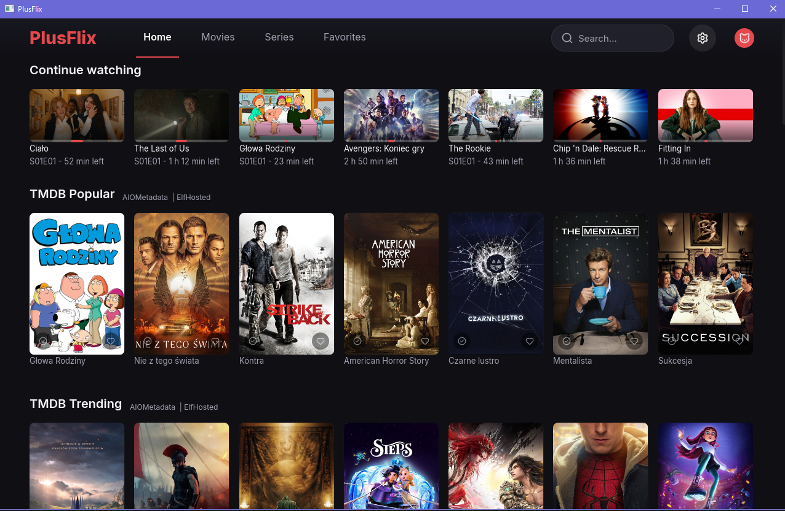
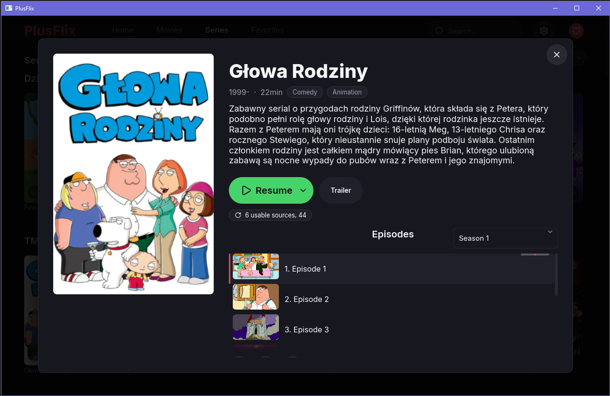
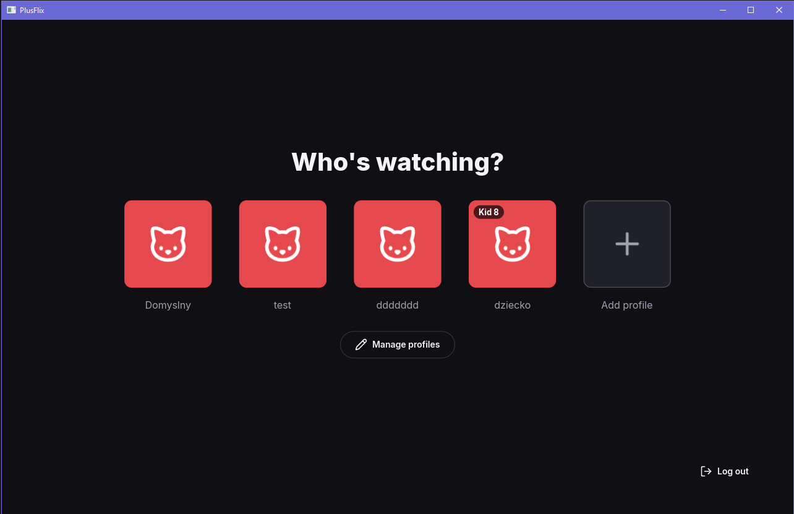

# PlusFlix

Hobby project — dogfooded daily at home; expect rough edges. Windows is the tested daily driver;
Linux and macOS should build and run but are untested. No prebuilt binaries — build from source.

PlusFlix is a simple Stremio client that picks the source for you. Open a title, press Play, and if a
stream fails or stalls it silently switches to the next-best one. Made for people who don't want to
deal with source lists, with profiles and a PIN-protected kid mode.





> PlusFlix is a client only: it hosts and provides no content, and it is not affiliated with Stremio.
> It plays only direct HTTP(S) streams from the addons installed on your Stremio account; torrent
> info-hash, YouTube and external-URL streams are intentionally skipped.

## Features

- Stremio account login; addons are read from the account's addon collection
- Pages: Home, Movies, Series, Favorites (+ Settings), details with episode list for series
- Up to 5 local profiles, each with its own favorites, watch progress and settings
- Continue Watching row on Home: local progress plus entries synced from the account's Stremio
  library. An entry counts when its type isn't "other", it isn't marked removed (a temporary removal
  still counts), and `state.timeOffset > 0`. PlusFlix additionally drops finished titles when merging.
- Interface language switcher (Settings → Language): English and Polski, applied immediately without
  restart, persisted in the store. Locale files in `crates/plusflix-app/locales/` (`en.json`,
  `pl.json`); missing keys fall back to English.
- Per-profile settings: player (mpv / VLC), audio language (prefer / must), subtitles language,
  subtitles requirement (required / required only if audio isn't the preferred language / not
  required), minimum quality, maximum file size, stream start timeout, buffering tolerance
- Sources load in the background as soon as a title (or episode) is opened

## Install & run

Platforms: Windows (tested daily driver), Linux and macOS (should build and run, untested). You need
a Rust toolchain.

```
cargo run --release -p plusflix-app
cargo test --workspace
```

mpv >= 0.38 must be on PATH. On Windows, `winget install mpv`, or put `mpv.exe` next to
`plusflix-app.exe`. The 0.38 floor exists because playback uses mpv's `loadfile` with an index
argument. IPC goes over a named pipe (Windows) / unix socket.

VLC is optional: only needed when a profile selects it in Settings. It is looked up on PATH or in the
standard Windows install directories.

## Data & security

Everything persistent — Stremio session key (auth key + email), profiles, favorites, watch progress,
settings — lives in one JSON file: plaintext, pretty-printed, written atomically (`.json.tmp` +
rename).

| OS      | Path                                              |
| ------- | ------------------------------------------------- |
| Windows | `%APPDATA%\PlusFlix\config\store.json`           |
| Linux   | `~/.config/plusflix/store.json`                   |
| macOS   | `~/Library/Application Support/PlusFlix/store.json` |

Your Stremio password is never stored — only the session key, and it sits unencrypted in that
plaintext file.

The parent PIN (see [Parental controls](#parental-controls)) is stored as a salted SHA-256 hash in
the same `store.json`, never plaintext. It is still bypassable by editing `store.json` (delete the
PIN hash, flip a profile's kind, or bump its age) — parental-control grade, not security. A forgotten
PIN means deleting `store.json`, which loses the profiles and settings.

## Configuration

### Source ranking

Order: audio language match, then quality, then debrid-cached, then subtitles available. Exact ties
break by arrival order (a sequence counter), never by addon collection order.

Audio language "prefer" only ranks; "must" rejects non-matching sources (untagged streams are
rejected too). Quality is the resolution tier parsed from the source name; streams without a quality
label default to 720p. Debrid-cached is sniffed from the source name: tokens like `[PL+]` or `⚡` mean
cached, `[PL download]` or `not cached` mean not cached, unknown is mid-ranked, never rejected.

### Addon priority

To make a specific addon win: Settings exposes a per-addon toggle "Wait for this addon before starting
playback" (per-profile `wait_for_addons` list of addon manifest ids, default empty). Playback is
deferred until the toggled addons' sources arrive, and those addons' sources then beat even
better-ranked sources from other addons.

Recipe for the Polish case: set the profile's audio language to Polish and flip the toggle on the
Polish-audio addon — its Polish sources win. Addon collection order alone does nothing to the ranking.

### Source switching

Stream start timeout 25 s default, stall/buffering timeout 10 s default. Both are per-profile
configurable (Settings → Source switching: "Stream start timeout" and "Buffering tolerance"),
5–300 s or empty = default. Timeouts scale up automatically while mpv pre-buffers.

## Parental controls

Profiles (up to 5) can be marked as child profiles by setting an age between 3 and 17 (children count
toward the cap). While a child profile is active, catalogs, search and genre pages show only titles
rated at or below the child's age; favorites and continue-watching are filtered the same way, and
opening an over-age title is blocked at playback. Unrated titles are treated as 18+ and hidden from
every child profile. The parent PIN gates entering an adult profile, creating/editing/deleting
profiles and manage mode; entering a child profile stays PIN-free.

With only Stremio's default Cinemeta addon installed nothing has age ratings, so a child profile's
catalog is empty — install a ratings-publishing addon (AIOMetadata works).

Full details: [docs/PARENTAL_CONTROLS.md](docs/PARENTAL_CONTROLS.md).

## How failover works

```
open title ──► SourceLoader (one task per addon) ──► SourcePool  ◄── next_untried(settings)
                                                        ▲                    │
                   keeps adding sources while playing ───┘                    ▼
Play ──► session::run ──► best untried source ──► mpv (loadfile ... start=<position>)
               ▲                                         │
               └── error / no start / stall / early EOF
```

When a source fails, the session loads the next best untried source into the same mpv window at the
last known position − 3 s — on retries only, and only once past the first 5 s of the video. Sources
that arrive late are kept as backups; the pool keeps adding sources while playing.

The numbers: a stream that doesn't start within 25 s fails over, and so does a stall longer than 10 s
(both defaults, per-profile configurable at 5–300 s or empty = default). A stream that ends more than
30 s before its known duration is treated as a dropped connection and switches to the next source.
Both timeouts scale up automatically while mpv pre-buffers.

## Project layout

- `crates/plusflix-core` – all logic, no UI: Stremio API, addon client, stream parsing, filtering,
  `SourcePool`, failover `session`, mpv/VLC players, profile store
- `crates/plusflix-app` – Slint UI and wiring

## License & credits

MIT — see [LICENSE](LICENSE).

The SVG icons in `crates/plusflix-app/ui/icons/` are from [Lucide](https://lucide.dev), ISC license;
`smile.svg`, `music.svg`, `trash-2.svg` and `gamepad.svg` come from Lucide v0.263.1 (renamed upstream
since).

The bundled Inter font files in `crates/plusflix-app/ui/fonts/` are licensed under the SIL Open Font
License 1.1; see `LICENSE.txt` in that directory.